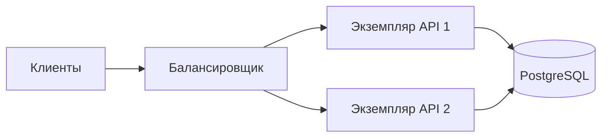
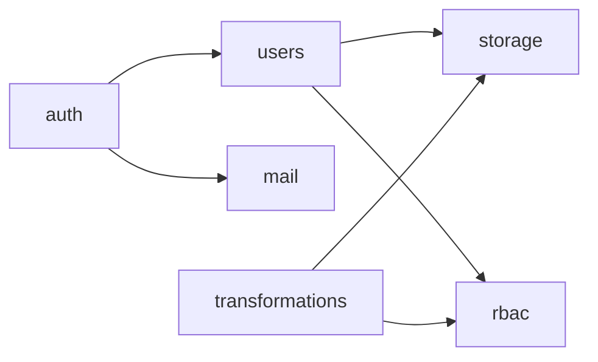
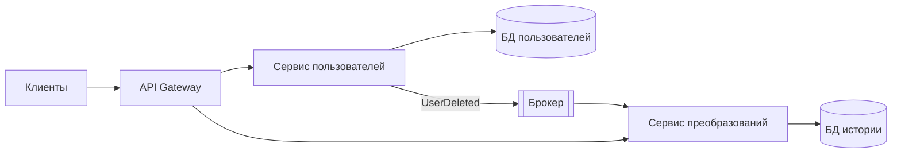
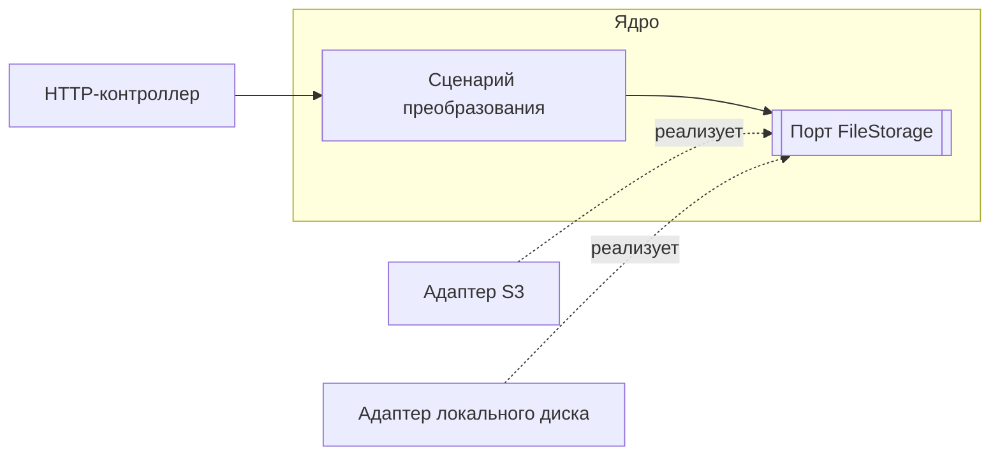

## **Содержание**

- [Два уровня архитектуры](#%D0%B4%D0%B2%D0%B0-%D1%83%D1%80%D0%BE%D0%B2%D0%BD%D1%8F-%D0%B0%D1%80%D1%85%D0%B8%D1%82%D0%B5%D0%BA%D1%82%D1%83%D1%80%D1%8B)
- [Монолит](#%D0%BC%D0%BE%D0%BD%D0%BE%D0%BB%D0%B8%D1%82)
- [Модульный монолит](#%D0%BC%D0%BE%D0%B4%D1%83%D0%BB%D1%8C%D0%BD%D1%8B%D0%B9-%D0%BC%D0%BE%D0%BD%D0%BE%D0%BB%D0%B8%D1%82)
- [Микросервисы](#%D0%BC%D0%B8%D0%BA%D1%80%D0%BE%D1%81%D0%B5%D1%80%D0%B2%D0%B8%D1%81%D1%8B)
- [SOA](#soa)
- [Serverless](#serverless)
- [События, CQRS](#%D1%81%D0%BE%D0%B1%D1%8B%D1%82%D0%B8%D1%8F-cqrs)
- [Архитектура внутри приложения](#%D0%B0%D1%80%D1%85%D0%B8%D1%82%D0%B5%D0%BA%D1%82%D1%83%D1%80%D0%B0-%D0%B2%D0%BD%D1%83%D1%82%D1%80%D0%B8-%D0%BF%D1%80%D0%B8%D0%BB%D0%BE%D0%B6%D0%B5%D0%BD%D0%B8%D1%8F)
- [Сравнение](#%D1%81%D1%80%D0%B0%D0%B2%D0%BD%D0%B5%D0%BD%D0%B8%D0%B5)
- [Как выбирать](#%D0%BA%D0%B0%D0%BA-%D0%B2%D1%8B%D0%B1%D0%B8%D1%80%D0%B0%D1%82%D1%8C)
- [Типичные ошибки](#%D1%82%D0%B8%D0%BF%D0%B8%D1%87%D0%BD%D1%8B%D0%B5-%D0%BE%D1%88%D0%B8%D0%B1%D0%BA%D0%B8)
- [Полезные ссылки](#%D0%BF%D0%BE%D0%BB%D0%B5%D0%B7%D0%BD%D1%8B%D0%B5-%D1%81%D1%81%D1%8B%D0%BB%D0%BA%D0%B8)
- [Вопросы по теории](#%D0%B2%D0%BE%D0%BF%D1%80%D0%BE%D1%81%D1%8B-%D0%BF%D0%BE-%D1%82%D0%B5%D0%BE%D1%80%D0%B8%D0%B8)

## **Два уровня архитектуры**

Системный уровень определяет, из скольких независимо развёртываемых частей состоит система: монолит, микросервисы, SOA, serverless. Уровень приложения определяет, как организован код внутри одной такой части: модули, слои, порты и адаптеры.

Проект курса — монолит. Код делится на модули по бизнес-функциям (`auth`, `users`, `rbac`, `transformations`, `storage`), а каждый модуль — на слои.

## **Монолит**

Всё приложение собирается в один артефакт и запускается как один процесс с одной базой данных. Модули вызывают друг друга обычными вызовами функций, без сети.

|Плюсы|Минусы|
|---|---|
|один репозиторий, одна сборка, один деплой|любое изменение требует пересборки всего приложения|
|вызовы между модулями быстрые и не теряются|без явных границ код срастается|
|одна транзакция охватывает данные любых модулей|ошибка в одном модуле останавливает весь процесс|
|просто запускать локально|нагруженную часть нельзя масштабировать отдельно|

Монолит масштабируется горизонтально целиком: несколько одинаковых экземпляров работают за балансировщиком. Это работает, только если экземпляр не хранит состояние в памяти процесса или на локальном диске. В курсе эту задачу решают JWT без серверных сессий и объектное хранилище вместо локального диска в production.

Подходит для MVP, небольших команд и большинства проектов на старте.

## **Модульный монолит**

Один процесс и один деплой, но код разделён на модули по бизнес-функциям:

- модуль открывает другим только публичный API. В NestJS это провайдеры из `exports`;
- модуль владеет своими таблицами, другие модули получают данные только через его API;
- зависимости направлены в одну сторону и не образуют циклов;
- общий код без бизнес-логики (конфигурация, логирование) выносится отдельно.

Стрелка означает «вызывает публичный API». Взаимный вызов `users` и `rbac` говорит о неудачных границах: общую часть выносят в отдельный модуль или заменяют вызов событием.

При росте нагрузки или команды модуль выносится в отдельный сервис: вызов внутри процесса заменяется сетевым, а владение таблицами уже разделено.

## **Микросервисы**

Система состоит из небольших сервисов. Каждый отвечает за одну бизнес-функцию, развёртывается независимо и владеет своей базой (database per service). Общение — по HTTP, gRPC или через брокер сообщений. Клиенты ходят в API Gateway: маршрутизация, проверка токенов, ограничение частоты.

После удаления пользователя сервис пользователей публикует `UserDeleted`. Сервис преобразований получает событие и удаляет свою историю. Общей транзакции у них нет.

|Плюсы|Минусы|
|---|---|
|сервисы масштабируются и выкладываются независимо|сетевой вызов медленнее и может не пройти|
|отказ одного сервиса не обязательно останавливает остальные|данные согласуются с задержкой|
|у каждой команды свой цикл релизов|нужны оркестрация, трассировка, мониторинг|
|каждый сервис может использовать свой стек|отладка сложнее, чем в одном процессе|

- **Saga** — операция из локальных транзакций разных сервисов. Неудачный шаг отменяется компенсирующим действием: при сбое бронирования возвращается списанная оплата.
- **Распределённый монолит** — сервисы, которые выкладываются только вместе или работают с общей базой. Сочетает минусы обоих подходов.
- **Закон Конвея.** Структура системы повторяет структуру коммуникаций в организации. Микросервисы окупаются, когда над системой работают несколько независимых команд.

Подходит для крупных систем и частей с сильно различающейся нагрузкой.

## **SOA**

Сервис-ориентированная архитектура — предшественник микросервисов. Сервисы крупные (клиенты, счета, склад) и переиспользуются разными приложениями. Связывает их корпоративная шина (ESB): маршрутизация, преобразование форматов, часто и бизнес-логика. Обмен обычно идёт по SOAP.

Главное отличие от микросервисов — где лежит логика интеграции. В SOA она в шине, которая становится узким местом. Микросервисы следуют принципу «умные сервисы, простые каналы»: логика в сервисах, брокер только доставляет сообщения.

Новые проекты SOA почти не выбирают. Подходит для интеграции унаследованных корпоративных систем.

## **Serverless**

Код оформляется как функции, которые облако запускает в ответ на события: HTTP-запрос, загрузка файла, сообщение в очереди, расписание. Серверы и масштабирование берёт на себя провайдер (AWS Lambda, Azure Functions, Yandex Cloud Functions). Оплата — за число вызовов и время выполнения. Модель называют FaaS.

|Плюсы|Минусы|
|---|---|
|нет серверов, которые нужно настраивать|холодный старт после простоя|
|масштабирование без настройки|ограничение времени, у AWS Lambda — 15 минут|
|при редких вызовах дешевле постоянно работающего сервера|при постоянной высокой нагрузке обычно дороже|
|быстрая выкладка отдельной функции|привязка к провайдеру, сложнее локальная отладка|

Функция не хранит состояние между вызовами. Сотни параллельных экземпляров исчерпывают `max_connections` PostgreSQL, если каждый открывает своё соединение, поэтому между функциями и базой ставят пул (PgBouncer, Amazon RDS Proxy).

Подходит для вебхуков, обработки загруженных файлов, задач по расписанию и редких пиков нагрузки.

## **События, CQRS**

Компонент публикует событие («пользователь удалён»), подписчики реагируют независимо. Отправитель не знает получателей и не ждёт результата. Подход используется и внутри монолита (фоновые задачи), и между сервисами.

Брокеры обычно доставляют сообщение хотя бы один раз, поэтому обработчик должен быть идемпотентным: повтор не меняет результат. Подробнее это разобрано в `0.4 Идемпотентность.md`. Если записать данные в базу, а затем отправить событие, сбой между шагами потеряет событие. Transactional outbox записывает событие в таблицу в той же транзакции, что и данные; отдельный процесс доставляет его в брокер. Задание удаления пользователя из `1.6` хранится в базе по той же причине.

**CQRS** разделяет модели записи и чтения. Команды меняют состояние и проверяют правила, запросы только читают данные в удобной форме. В простом варианте обе модели работают с одной базой. Отдельное хранилище для чтения нужно, когда нагрузка или форма данных сильно различаются. Для обычного CRUD CQRS только добавляет код. Это паттерн модуля, а не способ развёртывания: его применяют и внутри монолита.

## **Архитектура внутри приложения**

### **Слои**

|Слой|Отвечает за|Пример в NestJS|
|---|---|---|
|Представление|HTTP: маршруты, DTO, валидация, статусы|`UsersController`|
|Бизнес-логика|сценарии, правила, транзакции|`UsersService`|
|Доступ к данным|SQL или ORM|репозиторий TypeORM, Prisma Client|

Зависимости направлены только вниз. Контроллер не обращается к базе напрямую. Сервис ничего не знает об HTTP: не выбирает статус ответа и не читает cookies. Поэтому один сервис вызывают из контроллера, фоновой задачи или теста. В ASP.NET Core и FastAPI слои те же.

### **Порты и адаптеры**

Гексагональная архитектура развивает ту же идею. В центре — ядро со сценариями. Ядро объявляет интерфейсы (порты) для хранилища, почты, базы; инфраструктура реализует их адаптерами. Ядро не импортирует ни SDK хранилища, ни ORM.

Конкретный адаптер подставляет механизм внедрения зависимостей: провайдеры в NestJS, `IServiceCollection` в ASP.NET Core, `Depends` в FastAPI. Так в курсе подключаются хранилище файлов и преобразователи форматов.

Для простого CRUD полная гексагональная структура избыточна. Практичный компромисс — слои внутри модулей и интерфейсы только на границах с внешними системами.

## **Сравнение**

|Стиль|Развёртывание|Данные|Сложность|Подходит для|
|---|---|---|---|---|
|Монолит|одно приложение|одна база|низкая|MVP, небольшие команды|
|Модульный монолит|одно приложение, изолированные модули|одна база, таблицы закреплены за модулями|низкая|большинство новых проектов|
|Микросервисы|много сервисов|своя база у каждого|высокая|крупные системы, несколько команд|
|SOA|крупные сервисы и шина|часто общие базы|высокая|интеграция унаследованных систем|
|Serverless|отдельные функции|внешняя база и хранилище|средняя|событийная и неравномерная нагрузка|

## **Как выбирать**

1. Начинать с модульного монолита: он быстро разрабатывается и не закрывает путь к сервисам.
2. Выносить модуль в отдельный сервис только по конкретной причине: его нагрузка растёт независимо, над ним работает отдельная команда, нужен свой цикл релизов.
3. Serverless — для эпизодических задач вокруг основной системы: вебхуки, обработка файлов, расписание.
4. CQRS — точечно, там, где чтение и запись сильно расходятся.

## **Типичные ошибки**

|Что видно|Причина и исправление|
|---|---|
|Бизнес-логику нельзя проверить без HTTP-запроса|логика в контроллере, её переносят в сервис|
|Модуль выполняет SQL к таблицам другого модуля|данные получают через публичный API модуля|
|Модули импортируют друг друга по кругу|неудачные границы, общую часть выделяют или заменяют вызов событием|
|Микросервисы выкладываются только вместе|распределённый монолит: общая база или жёстко связанные контракты|
|Отказ одного сервиса останавливает цепочку|нет таймаутов, часть вызовов стоит заменить событиями|
|Второй экземпляр API отвечает иначе, чем первый|состояние в памяти процесса, его переносят в базу или кеш|
|Повторная доставка события выполнила действие дважды|обработчик не идемпотентен|
|Serverless-функции исчерпали соединения с базой|каждая функция открывает своё соединение, нужен пул|

## **Полезные ссылки**

### **Общие**

- [Martin Fowler — Microservices](https://www.google.com/url?sa=E&q=https%3A%2F%2Fmartinfowler.com%2Farticles%2Fmicroservices.html) — определение и характеристики микросервисов.
- [Martin Fowler — MonolithFirst](https://www.google.com/url?sa=E&q=https%3A%2F%2Fmartinfowler.com%2Fbliki%2FMonolithFirst.html) — почему проект начинают с монолита.
- [Martin Fowler — Serverless Architectures](https://www.google.com/url?sa=E&q=https%3A%2F%2Fmartinfowler.com%2Farticles%2Fserverless.html) — устройство и компромиссы serverless.
- [Martin Fowler — CQRS](https://www.google.com/url?sa=E&q=https%3A%2F%2Fmartinfowler.com%2Fbliki%2FCQRS.html) — когда разделение моделей оправдано.
- [microservices.io — Patterns](https://www.google.com/url?sa=E&q=https%3A%2F%2Fmicroservices.io%2Fpatterns%2F) — Saga, Database per service, API Gateway, Transactional outbox.
- [Alistair Cockburn — Hexagonal Architecture](https://www.google.com/url?sa=E&q=https%3A%2F%2Falistair.cockburn.us%2Fhexagonal-architecture) — порты и адаптеры.
- [The Twelve-Factor App](https://www.google.com/url?sa=E&q=https%3A%2F%2F12factor.net%2Fru%2F) — приложение без состояния, которое можно запускать в нескольких экземплярах.

### **По языку**

#### **Node.js**

- [NestJS — Modules](https://www.google.com/url?sa=E&q=https%3A%2F%2Fdocs.nestjs.com%2Fmodules) — границы модулей, `imports` и `exports`.
- [NestJS — Custom providers](https://www.google.com/url?sa=E&q=https%3A%2F%2Fdocs.nestjs.com%2Ffundamentals%2Fcustom-providers) — подмена реализации интерфейса через DI.
- [NestJS — Microservices](https://www.google.com/url?sa=E&q=https%3A%2F%2Fdocs.nestjs.com%2Fmicroservices%2Fbasics) — транспорты для взаимодействия сервисов.

#### **.NET**

- [Microsoft — Common web application architectures](https://www.google.com/url?sa=E&q=https%3A%2F%2Flearn.microsoft.com%2Fen-us%2Fdotnet%2Farchitecture%2Fmodern-web-apps-azure%2Fcommon-web-application-architectures) — монолит, слои и чистая архитектура в ASP.NET Core.
- [.NET — Dependency injection](https://www.google.com/url?sa=E&q=https%3A%2F%2Flearn.microsoft.com%2Fen-us%2Fdotnet%2Fcore%2Fextensions%2Fdependency-injection%2Foverview) — регистрация реализаций интерфейсов.

#### **Python**

- [FastAPI — Bigger Applications](https://www.google.com/url?sa=E&q=https%3A%2F%2Ffastapi.tiangolo.com%2Ftutorial%2Fbigger-applications%2F) — разделение приложения на модули с `APIRouter`.
- [FastAPI — Dependencies](https://www.google.com/url?sa=E&q=https%3A%2F%2Ffastapi.tiangolo.com%2Ftutorial%2Fdependencies%2F) — внедрение зависимостей.
- [Cosmic Python](https://www.google.com/url?sa=E&q=https%3A%2F%2Fwww.cosmicpython.com%2F) — репозиторий, unit of work и события на Python.

## **Вопросы по теории**

1. Почему монолит можно масштабировать горизонтально и что мешает запустить второй экземпляр приложения?
2. Что произойдёт, если брокер доставит событие повторно, а обработчик не идемпотентен?
3. В каких задачах serverless дешевле постоянно работающего сервера, а в каких дороже?
4. Чем CQRS отличается от разделения на микросервисы и обязательна ли для него отдельная база для чтения?
5. Почему в гексагональной архитектуре интерфейс хранилища принадлежит ядру, а реализация S3 — адаптеру?

### Чем модульный монолит отличается от обычного и какие правила не дают модулям срастись?

**Обычный монолит** собирается в единый артефакт, работает как один процесс и использует общую базу данных[1]. Главная его проблема — отсутствие жестких границ в коде, из-за чего со временем модули и классы начинают ссылаться друг на друга хаотично («срастаются»)

**Модульный монолит** точно так же разворачивается как единый процесс и единая база, однако кодовая база внутри него строго разделена на автономные модули по бизнес-функциям (например, `auth`, `users`, `rbac`, `transformations`, `storage`)

### Почему у каждого микросервиса своя база данных и как согласовать данные нескольких сервисов без общей транзакции?

